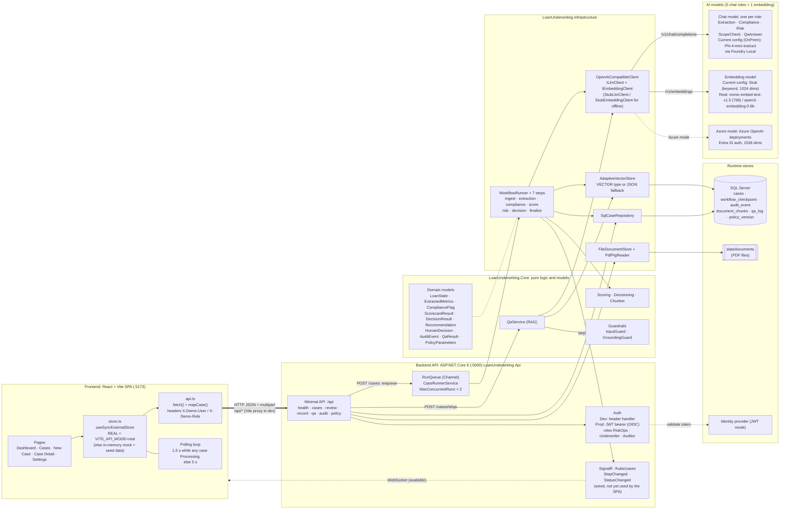
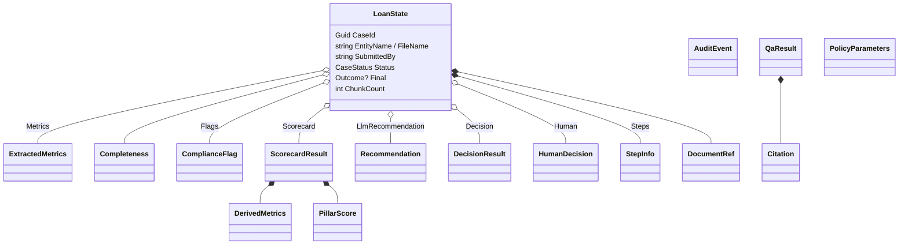
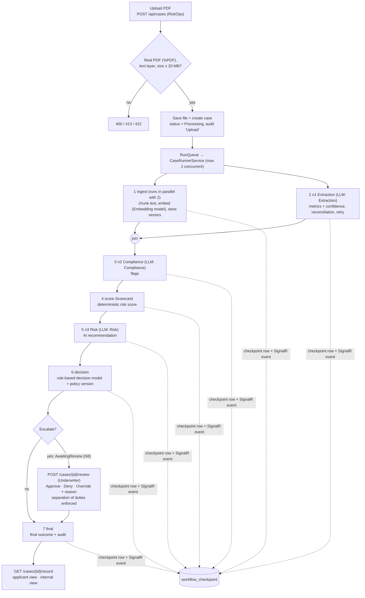

# Loan Underwriting Orchestrator — Architecture

Mermaid diagrams: render in GitHub, VS Code (Markdown Preview Mermaid Support) or any Mermaid viewer.
Verified against the code on 2026-10-18 (backend `net8.0`, frontend React/Vite).

## 1. System overview: frontend ↔ backend ↔ models



Solid thick arrow = the frontend's only live channel today (REST). SignalR is registered on the server
(`/hubs/cases`, proxied in `vite.config.ts`) but `store.ts` polls instead of subscribing.

## 2. Frontend → backend API contract

| UI action (`store.ts`) | `api.ts` call | Endpoint | Roles allowed | Response |
|---|---|---|---|---|
| Load/refresh cases (poll) | `fetchCases` → `fetchCase` | `GET /api/cases`, then per case `GET /api/cases/{id}`, `GET /api/cases/{id}/qa`, `GET /api/cases/{id}/audit` | all (audit: Underwriter, Auditor; 403 is tolerated for RiskOps) | `LoanState` JSON mapped by `mapCase()` |
| Submit loan document | `uploadCase` | `POST /api/cases` (multipart `file`) | RiskOps | `202 { caseId }` |
| Approve / Deny / Override | `postReview` | `POST /api/cases/{id}/review` `{action, reason, finalDecision}` | Underwriter (not the submitter) | updated `LoanState` |
| Ask a question | `postQuestion` | `POST /api/cases/{id}/qa` `{question}` | RiskOps, Underwriter | `{answer, citations, refused, reason}` |
| Download record | `fetchRecord` | `GET /api/cases/{id}/record?view=applicant\|internal` | all (`internal`: Underwriter, Auditor) | applicant / internal record |
| Delete all documents | `deleteAllCases` | `DELETE /api/cases` | Underwriter | `{deleted, skipped}` |
| Health, policy | n/a | `GET /api/health` (anonymous), `GET /api/policy` | all | status / `PolicyParameters` |

Auth: in `Auth:Mode=Dev` (Development) the SPA sends `X-Demo-User` and `X-Demo-Role`; in `Jwt` mode the backend
expects `Authorization: Bearer` (and `?access_token=` for `/hubs`). CORS allows `http://localhost:5173/5174`.

## 3. Models

### 3.1 AI models

| Role (`ModelRole`) | Used by | Purpose | Configured model (OnPrem) |
|---|---|---|---|
| `Extraction` | ExtractionStep | Pull required financial metrics + per-field confidence from the PDF | `Phi-4-mini-instruct-generic-gpu:5` |
| `Compliance` | ComplianceStep | Raise compliance flags with evidence | same |
| `Risk` | RiskStep | AI recommendation (Approve / Deny / Escalate) and rationale | same |
| `ScopeCheck` | QaService | Classify whether a question is about the document | same |
| `QaAnswer` | QaService | Answer from retrieved excerpts only, with citations | same |
| Embedding | IngestStep, QaService | Embed chunks and questions for vector search | `EmbeddingProvider: Stub`, 1024 dims (Dev) |

Endpoint: Foundry Local `http://localhost:5273/v1` (OpenAI-compatible, no auth). Azure mode swaps in Azure OpenAI
deployments with Entra ID. `document_chunks.embedding` is `VECTOR(EmbeddingDimensions)`; change dimensions only with a re-ingest.
The scorecard (`Scoring`) and the decision model (`Decisioning`, policy `DM-1.0.0`: approve < 30, deny > 70, min confidence 0.80)
are deterministic code, not LLMs.

### 3.2 Domain models (`LoanUnderwriting.Core/Models.cs`)



Enums: `CaseStatus` (Processing, AwaitingReview, Approved, Denied, Error), `Outcome` (Approve, Deny, Escalate),
`Severity`, `RefusalReason` (None, OutOfScope, NotFound, Blocked, Injection). `LoanState` is an immutable record; each step returns a copy.

## 4. Underwriting workflow (per case)



On startup the runner re-queues any case still in `Processing`, and resumes from the last checkpoint.

## 5. Grounded Q&A (RAG)

```mermaid
sequenceDiagram
    participant UI as SPA (api.postQuestion)
    participant API as POST /api/cases/{id}/qa
    participant G as InputGuard
    participant L as Chat model
    participant E as Embedding model
    participant V as Vector store (SQL)
    UI->>API: question
    API->>G: length, injection, decision-integrity checks
    G-->>API: allowed? (else refuse: Blocked / Injection)
    Note over API: "analyst commentary" questions are answered from the stored AI rationale, no retrieval
    API->>L: ScopeCheck → {"in_scope": bool}  (fail closed)
    API->>E: embed question
    API->>V: top-K 20 for this case, max cosine distance 0.85
    V-->>API: chunks (none within gate → NotFound)
    API->>L: QaAnswer from excerpts only → answer + citations
    API->>API: citations must map to excerpts; GroundingGuard checks every figure
    API->>V: qa_log + audit_event written
    API-->>UI: answer + citations, or refused + reason
```

## 6. Deployment modes

| | OnPrem (default) | Azure |
|---|---|---|
| Model endpoint | Foundry Local `http://localhost:5273/v1` | Azure OpenAI `/openai/v1` |
| Auth to models | None | Entra ID (`cognitiveservices` scope) or API key |
| Chat models | `Phi-4-mini-instruct-generic-gpu:5` for all 5 roles | one deployment name per role |
| Embedding | `EmbeddingProvider: Stub` today (1024 dims); real options `nomic-embed-text-v1.5` (768), `qwen3-embedding-0.6b` | embedding deployment, 1536 dims |
| Vector store | `Native` (prod) / `Auto` (Development) / `JsonFallback`; Azure must be native | native `VECTOR` |
| Host | Windows Service (`deploy/onprem/deploy.ps1`), also serves the built SPA | same API |

Startup runs `SchemaInitializer` then `SelfCheck` (mode/adapters consistency, DB, vector support, document folder,
and per-role model probes unless `ProbeModels` is false). A failed check stops the app.

## 7. Layers

| Project | Responsibility |
|---|---|
| `frontend/` | React/TypeScript SPA, store with real/mock modes, polling, role switcher |
| `LoanUnderwriting.Api` | Minimal API endpoints, auth (Dev/JWT), CORS, SignalR hub, run queue + background runner, startup schema + self-check |
| `LoanUnderwriting.Core` | Models, abstractions, chunking, scoring, decisioning, guardrails, Q&A |
| `LoanUnderwriting.Infrastructure` | SQL repositories, vector stores, LLM/embedding client, PDF/file storage, workflow steps, composition root |
| `backend/tests/` | Core, pipeline and SQL integration tests |
